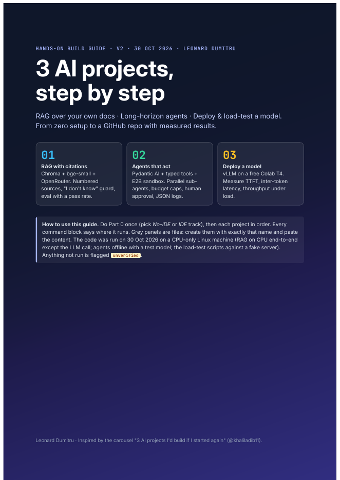

# AI Projects: Step-by-Step Build Guide

**By Leonard Dumitru** · [Project page](https://darkanalytica1.github.io/projects/ai-projects-guide/) · [Download the PDF (53 pages)](AI_Projects_Step_by_Step_Guide.pdf) · [Read online](docs/guide.html)

<p align="center"></p>

A granular, start-to-finish guide to building three practical AI systems, with complete code for each one. Every project has two setup tracks:

- **No IDE:** Google Colab in the browser, nothing to install.
- **IDE:** VS Code or Cursor on macOS or Windows, with a virtual environment.

Each project then walks through numbered steps with full code, a "done when" checklist and a table of common errors and fixes. The guide also includes an end-to-end journey map, detailed flow diagrams with numbered review checkpoints, worked eval examples, a reviewer's checklist and an error gallery for each project, diagnostic decision trees, and a page on how to read an eval report.

## The three projects

| # | Project | What you build | How you know it works |
|---|---|---|---|
| 01 | [RAG over your own docs](01-rag/) | Ingest PDFs/text, embed with sentence-transformers, store in Chroma (FAISS alternative), answer through an OpenAI-compatible LLM (OpenRouter) with citations | An evaluation script reports retrieval hit-rate and an answer pass rate (regex checks, optional LLM-as-judge) |
| 02 | [Long-horizon agents](02-agents/) | A Pydantic AI agent with tools, running code in an E2B or Docker sandbox, with guardrails, step-by-step logging and a test suite | `run_tests.py` runs a task set and reports pass/fail per task, with JSONL step logs |
| 03 | [Serve an open-weights model](03-deploy/) | vLLM serving an open model on a free GPU (Colab T4), exposed as an OpenAI-compatible endpoint (SGLang noted as an alternative) | `load_test.py` and `metrics_summary.py` measure TTFT, inter-token latency and throughput across concurrency levels |

## Quick start

Python 3.11+ recommended. Each project is self-contained.

### 01 · RAG

```bash
cd 01-rag
python -m venv .venv && source .venv/bin/activate   # Windows: .venv\Scripts\activate
pip install -r requirements.txt   # sentence-transformers, chromadb, datasets, pypdf, openai, python-dotenv (+ optional faiss-cpu)
cp .env.example .env              # add your OPENROUTER_API_KEY
python ingest.py --hf --limit 2000 # index the rag-mini-wikipedia test set
python ingest.py --pdfs my_docs    # or index your own PDFs
python rag.py "your question" --no-llm   # retrieval only, no key needed
python rag.py "your question"            # answer with citations
python eval.py --n 50 --retrieval # retrieval hit-rate, no API key needed
python eval.py --n 50 --judge     # answer quality, needs a key
```

### 02 · Agents

```bash
cd 02-agents
python -m venv .venv && source .venv/bin/activate
pip install -r requirements.txt   # pydantic-ai-slim[openrouter], e2b-code-interpreter, python-dotenv
cp .env.example .env              # add OPENROUTER_API_KEY, plus E2B_API_KEY (or set SANDBOX=docker)
python agent.py "Write hello.md that says hello"
python run_tests.py
```

### 03 · Deploy

```bash
# On the GPU machine (Colab T4 / Lightning):
pip install vllm
vllm serve unsloth/Llama-3.2-1B-Instruct --dtype half --max-model-len 4096

# From any machine:
cd 03-deploy
pip install -r requirements.txt   # client side only needs httpx
python load_test.py --concurrency 1 4 16 --requests 32 --max-tokens 128
python metrics_summary.py --url http://localhost:8000
```

`colab_cells.py` has the notebook cells to paste into Colab, `fake_server.py` lets you try the load-test client without a GPU, and `README_template.md` is a results write-up to fill in.

## Repository layout

```
AI_Projects_Step_by_Step_Guide.pdf   the full 53-page guide
docs/guide.html, docs/cover.png      the guide as a web page, and its cover
01-rag/                              ingest, retrieve, answer with citations, evaluate
02-agents/                           agent, sandbox, logger, tests/tasks.json
03-deploy/                           Colab cells, load test, metrics summary
```

## Testing status

- **Tested on CPU:** the RAG ingestion and retrieval pipeline (on a Wikipedia QA test set, retrieval found the right passage for 60 of 100 questions) and the agent code paths that run without an API key.
- **Not yet tested end to end:** anything that needs your own API key or a GPU, namely the LLM-generated answers and LLM judge, the E2B cloud sandbox, and vLLM on a T4. The guide marks these steps and gives fallbacks.
- Results will vary with your documents, model and hardware. Treat the numbers above as a baseline, not a benchmark.

## Keys and safety

The repo contains **placeholder keys only** (`.env.example`). Copy it to `.env`, which is git-ignored, and never commit real keys. Run agent-generated code only inside the sandbox.

## License

[MIT](LICENSE) © 2026 Leonard Dumitru
